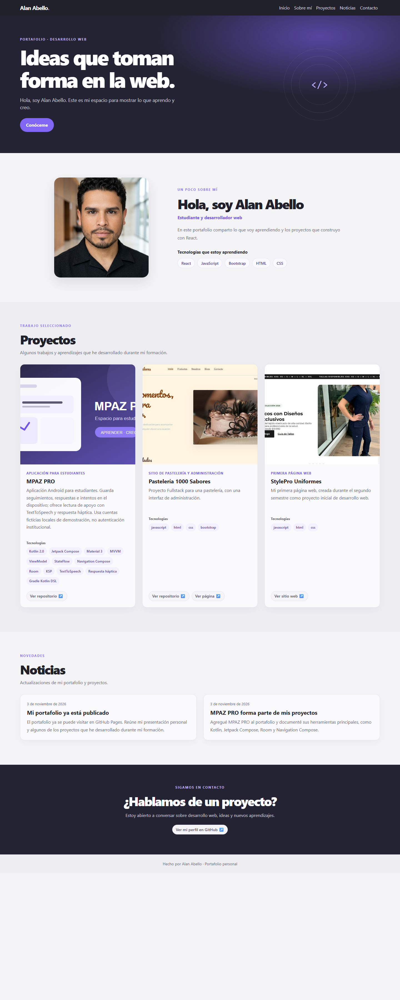

# Portafolio de Alan Abello

Portafolio personal creado con React, Vite y Bootstrap. Presenta mi perfil, proyectos académicos y noticias cargadas desde un archivo JSON.

## Captura



## Ver el sitio

[Abrir portafolio en GitHub Pages](https://abelloderian19-dotcom.github.io/mi_portafolio/)

## Requisitos

- Node.js LTS y npm.
- Chrome para ejecutar las pruebas predeterminadas. Firefox también se puede usar si está instalado.

## Instalar y ejecutar

```bash
npm install
npm run dev
```

Vite muestra en la terminal la dirección local para abrir en el navegador.

## Comandos disponibles

| Comando | Para qué sirve |
| --- | --- |
| `npm run dev` | Inicia el servidor de desarrollo. |
| `npm run build` | Compila el sitio para producción en `dist/`. |
| `npm run preview` | Sirve localmente la compilación de `dist/`. |
| `npm run lint` | Revisa el código con ESLint. |
| `npm test` | Ejecuta Jasmine y Karma en Chrome Headless y genera cobertura. |
| `npm run test:firefox` | Ejecuta las pruebas en Firefox Headless. |
| `npm run test:browsers` | Ejecuta las pruebas en Chrome y Firefox. |

Después de las pruebas, abre `coverage/index.html` para ver el informe de cobertura. Firefox debe estar instalado para usar los comandos de Firefox o de ambos navegadores.

## Estructura principal

```text
public/
  data/noticias.json       Noticias editables
  images/                  Foto de perfil e imágenes de proyectos
src/
  components/              Secciones y tarjetas React
  data/proyectos.js        Datos de los proyectos
  tests/                   Pruebas de componentes e interacciones
  App.jsx                  Composición de las secciones
karma.conf.cjs             Configuración de Karma y cobertura
```

## Editar el contenido

- **Perfil:** cambia el objeto `perfil` en `src/App.jsx`.
- **Proyectos:** edita la lista de `src/data/proyectos.js`. Cada proyecto tiene imagen, descripción, tecnologías y enlace.
- **Noticias:** edita `public/data/noticias.json`. Cada noticia necesita `id`, `titulo`, `fecha` en formato `AAAA-MM-DD` y `contenido`.

El componente `Noticias` carga el JSON con `fetch`, guarda el resultado en `useState` y muestra los estados de carga y error.

## Publicación en GitHub Pages

El flujo de GitHub Actions en `.github/workflows/deploy.yml` compila y publica `dist/` al actualizar la rama `main`. En **Settings → Pages**, la fuente debe estar configurada como **GitHub Actions**. `vite.config.js` usa `/mi_portafolio/` como ruta base del repositorio.

## Accesibilidad y rendimiento

- Las imágenes tienen texto alternativo; las imágenes de las tarjetas se cargan de forma diferida.
- Las capturas usadas en las tarjetas se redimensionaron y comprimieron; sus originales se conservan en `docs/originales/`.
- El menú móvil informa su estado con `aria-expanded` y puede manejarse con teclado.
- Los estilos incluyen foco visible y respetan la preferencia de movimiento reducido.
- La compilación de producción minifica los recursos de JavaScript y CSS.

## Preparación de la presentación

Consulta [la guía de presentación](docs/presentacion.md) para repasar la estructura, decisiones y conceptos principales del proyecto.
